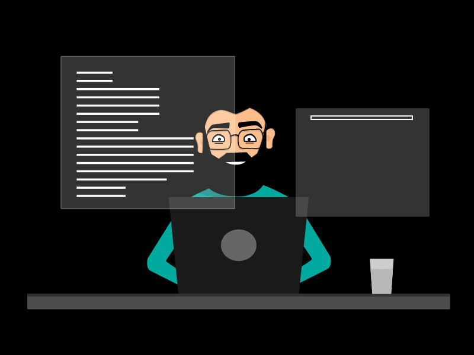

<!-- View Counter -->

  
  
  
  

---

## 👨‍💻 About Me

- 🎓 Software Engineer
- 🔭 Passionate about building web applications and exploring new tech
- 💻 Focus: **Laravel**, **Node.js**, **React**, **TypeScript**
- 🌱 Currently learning more in **TypeScript** and **System Design**
- 🎮 Hobbies: Gaming, Football, Running, Music, and Tech Talks

---

## ⚡ Tech Stack

### Programming Languages

  
  
  

### Frameworks & Tools

  
  
  
  
  
  

### Tools & IDEs

  
  
  
  

---

## 📊 GitHub Stats

<table>
<tr>
  <td width="48%">
    
    
  </td>
  <td width="52%">
    
  </td>
</tr>
</table>

---

## 📬 Contact Me

- 📧 **Email:** [quanghuybest@gmail.com](mailto:quanghuybest@gmail.com)
- 🌐 **Blog:** [https://daihoctrongtoi.blogspot.com](https://daihoctrongtoi.blogspot.com)
